# Contributing to OpenReport

Welcome to OpenReport! We are excited to collaborate with open-source contributors, reporting engineers, and developers worldwide.

---

### Figure 14.1: Open Source Contribution Lifecycle

```mermaid
flowchart LR
    subgraph LocalDev ["1. Local Development"]
        FORK["Fork & Clone Repo<br/>git clone https://github.com/ssoad/OpenReport.git"]
        BRANCH["Feature Branch<br/>git checkout -b feature/my-enhancement"]
        CODE["Implement Code & Add Tests"]
        VERIFY["Local Verification<br/>pnpm test && pnpm typecheck"]
        FORK --> BRANCH --> CODE --> VERIFY
    end

    subgraph CIReview ["2. Review & Continuous Integration"]
        PR["Open Pull Request on GitHub"]
        GHA["Automated CI Verification<br/>(Strict TypeScript, 35+ Unit Tests)"]
        REV["Maintainer Code Review & Feedback"]
        PR --> GHA --> REV
    end

    subgraph ReleaseStage ["3. Merged to Main"]
        MERGE["Squash & Merge to main"]
        PAGES["Automated GitHub Pages Deployment"]
        MERGE --> PAGES
    end

    VERIFY --> PR
    REV --> MERGE
```



---

## Code of Conduct
We are committed to providing a welcoming, inclusive, and harassment-free environment for everyone. Please be respectful and constructive in all discussions.

## Development Setup

### Prerequisites
- Node.js >= 20.0.0
- pnpm >= 9.0.0 (or npm)

### Initializing the Workspace
```bash
# Clone the repository
git clone https://github.com/ssoad/OpenReport.git
cd OpenReport

# Install dependencies
pnpm install

# Run all unit and integration tests
pnpm test

# Build all packages
pnpm build

# Launch OpenReport Studio in development mode
pnpm dev
```

## Pull Request Guidelines
1. Ensure all new features are accompanied by automated unit or integration tests.
2. Maintain zero type-check errors (`pnpm typecheck`).
3. Follow the established code formatting and naming conventions.
4. Update relevant documentation in `docs/` and summarize your changes in `CHANGELOG.md`.
