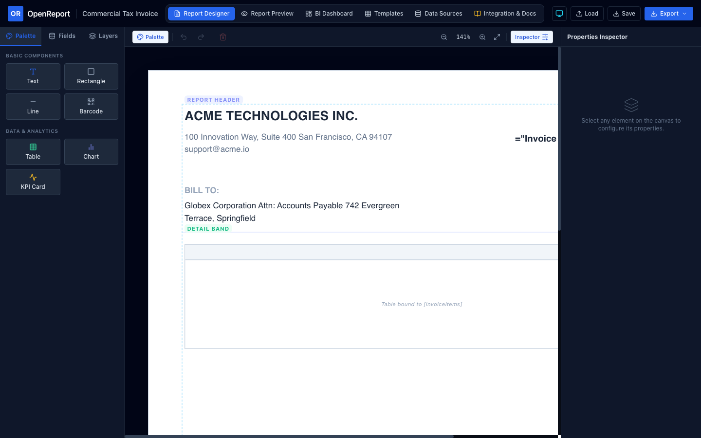
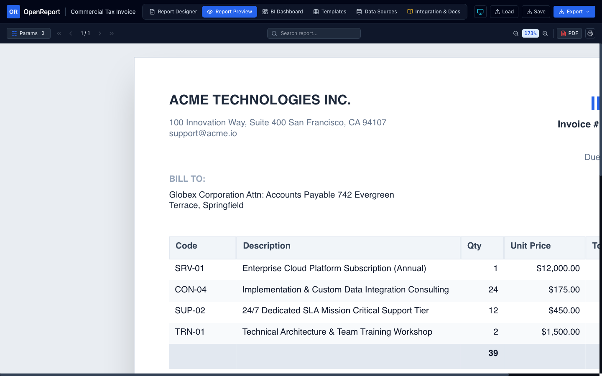
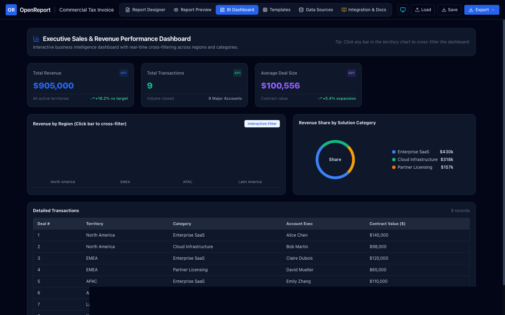

# OpenReport

<p align="center">
  <strong>The Next-Generation, Open-Source Reporting & Analytics Platform</strong>
</p>

<p align="center">
  <a href="https://github.com/openreport/openreport/actions/workflows/ci.yml"></a>
  <a href="https://github.com/openreport/openreport/blob/main/LICENSE"></a>
  <a href="#"></a>
  <a href="#"></a>
  <a href="https://openreport.github.io/openreport/"></a>
</p>

<p align="center">
  A developer-first, universal reporting engine combining pixel-perfect paginated document design, interactive report viewing, business intelligence dashboards, multi-format exports (PDF, Excel, CSV), and a sandboxed calculation language.
</p>

---

## Visual Showcase

### 1. In-Browser Visual Report Designer
> Desktop-class drag-and-drop banded report designer with snapping grid, precision rulers, component palette, field tree, and property inspector.



### 2. Interactive Paginated Report Viewer
> Embeddable multi-page document viewer with live parameter filtering, document search, zoom controls, and vector PDF exports.



### 3. Business Intelligence & Analytics Dashboard
> Responsive multi-column dashboard with interactive KPI cards, revenue charts, and real-time cross-filtering.



---

## Highlights

- 📄 **Pixel-Accurate Paginated Reports**: True banded document layout engine (`ReportHeader`, `PageHeader`, `GroupHeader`, `Detail`, `GroupFooter`, `PageFooter`, `ReportFooter`) with multi-pass pagination (`Page N of M`), dynamic content measurement, and keep-together constraints.
- 🎨 **Visual Drag-and-Drop Designer**: Desktop-class in-browser report studio with snapping grid, precision rulers, component palette, visual data binding, and undo/redo history.
- 👁️ **Interactive Report Viewer**: Embeddable viewer with single-page and continuous scrolling, zoom controls (25% to 500%), interactive parameter panel, search, and one-click exports.
- 📊 **Business Intelligence Dashboards**: Responsive grid-based dashboards with interactive KPI cards, charts (bar, line, area, donut), and interactive cross-filtering.
- 🔒 **Zero-Trust Expression Engine**: Custom AST parser and evaluator providing rich arithmetic, string, date/time, logical, and aggregation operations with zero `eval()` or code execution risks.
- 📤 **High-Fidelity Multi-Target Exporters**:
  - **PDF**: Multi-page vector PDF generation with borders, text, and graphics.
  - **Excel (XLSX)**: Native OpenXML spreadsheets with typed dates, numbers, formulas, and column widths.
  - **CSV**: RFC-4180 compliant with built-in formula-injection mitigation.
  - **HTML / SVG**: Semantic web and vector graphics output.
- 🌐 **Universal & Embeddable**: Framework-agnostic core runnable in modern browsers, Node.js, Bun, Edge runtimes, or embeddable directly into React applications.
- ⚡ **Open-Source CLI**: `openreport` command-line tool to validate, inspect, and export report documents headlessly.

---

## Monorepo Structure

```text
packages/
  ├── schema/          # Universal JSON report specification, types & validation
  ├── expressions/     # Safe AST parser, evaluator & formatting library
  ├── data-engine/     # Data providers (Memory, JSON, CSV) & query processor
  ├── layout-engine/   # Banded document layout, pagination & text metrics
  ├── exporters/       # PDF (pdf-lib), Excel (exceljs), CSV & HTML exporters
  ├── core/            # Unified OpenReport engine facade
  ├── designer-react/  # Visual drag-and-drop report designer component
  ├── viewer-react/    # Embeddable interactive report viewer component
  ├── dashboard/       # BI dashboard engine, widgets & cross-filtering
  └── cli/             # Command-line utility (validate, inspect, export)
apps/
  └── studio/          # Standalone OpenReport Studio web application
```

---

## Quick Start

### Installation

```bash
# Clone the repository
git clone https://github.com/openreport/openreport.git
cd openreport

# Install dependencies
pnpm install

# Run the automated test suite
pnpm test

# Launch OpenReport Studio
pnpm dev
```

### Programmatic Usage

```typescript
import { OpenReportEngine } from '@openreport/core';
import { PdfExporter, CsvExporter, XlsxExporter } from '@openreport/exporters';

// 1. Initialize engine with a report specification
const engine = new OpenReportEngine(salesReportDefinition);

// 2. Supply or bind runtime data
await engine.loadData({
  orders: [
    { orderId: 'ORD-101', customer: 'Acme Corp', amount: 1450.50, date: '2026-10-15' },
    { orderId: 'ORD-102', customer: 'Globex Inc', amount: 820.00,  date: '2026-10-18' }
  ]
});

// 3. Render paginated document model
const document = await engine.renderDocument();

// 4. Export to PDF, Excel, or CSV
const pdfBytes = await PdfExporter.exportToBuffer(document);
const csvString = await CsvExporter.exportToString(document);
```

---

## Documentation

- [Product Vision](docs/PRODUCT_VISION.md)
- [System Architecture](docs/ARCHITECTURE.md)
- [DevExpress Feature Parity Matrix](docs/FEATURE_PARITY.md)
- [Implementation Roadmap](docs/ROADMAP.md)
- [Security & Zero-Trust Model](docs/SECURITY.md)
- [Universal Report Specification Schema](docs/REPORT_SCHEMA.md)
- [Plugin Development Guide](docs/PLUGIN_DEVELOPMENT.md)
- [Testing & Quality Assurance](docs/TESTING.md)

---

## License

Licensed under the [Apache License, Version 2.0](LICENSE).
