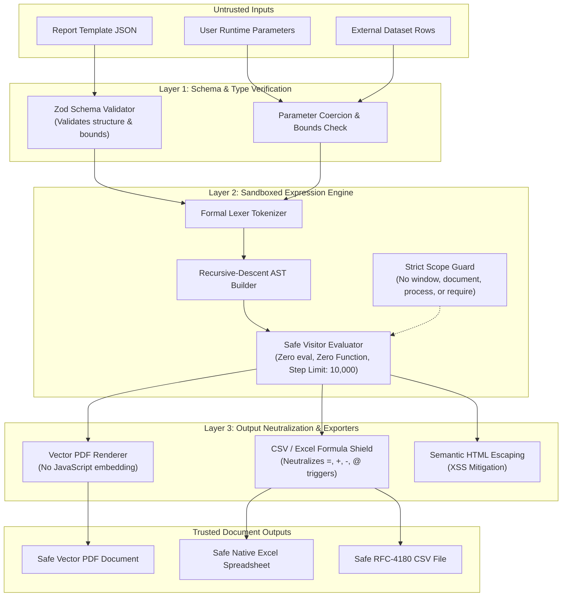

# OpenReport Security Model

## 1. Threat Model & Philosophy
OpenReport is designed from the ground up under the principle of **Zero-Trust Execution**. Report templates, parameter inputs, and dataset contents are treated as untrusted data.

---

### Figure 8.1: Zero-Trust Security & Sandboxing Architecture

---

## 2. Key Security Safeguards

### 2.1 Sandboxed Expression Evaluation (Zero `eval`)
Many traditional reporting tools (and legacy JavaScript engines) evaluate user expressions using `eval()`, `new Function()`, or script engines that expose host object scopes (`process`, `window`, prototype pollution, etc.).

**OpenReport strictly forbids code execution:**
- Custom Tokenizer and AST (Abstract Syntax Tree) Parser.
- Strict Visitor-based Evaluator with a finite, allowlisted mathematical and string function table.
- No access to global objects (`window`, `document`, `global`, `process`, `require`, `import`).
- Execution step counter and loop limits to prevent Infinite Loop / Denial of Service (ReDoS / algorithmic complexity attacks).

### 2.2 CSV & Spreadsheet Formula Injection Protection
When exporting user-supplied strings into CSV or Excel files, malicious strings beginning with `=`, `+`, `-`, `@`, `\t`, or `\r` can trigger external command execution or DDE attacks when opened in Microsoft Excel or Google Sheets.

**Mitigation:**
OpenReport's CSV and Excel exporters automatically sanitize and quote formulas. Leading formula trigger characters are prepended with an apostrophe (`'`) or safely escaped, rendering them as inert text strings.

### 2.3 Parameterized Queries & Data Isolation
- Data providers enforce parameterized queries to prevent SQL and NoSQL injection.
- Credentials (such as database passwords and API tokens) are strictly isolated on server execution contexts and never serialized into client-side report definitions.

### 2.4 Multi-Tenancy & Authorization Boundaries
- Dataset requests accept an ambient `SecurityContext` containing user tenant ID, roles, and permissions.
- Row-level security (RLS) filters are applied to queries before execution.

## 3. Vulnerability Reporting
To report a security vulnerability, please email `security@openreport.org` or open a confidential security advisory on GitHub.
