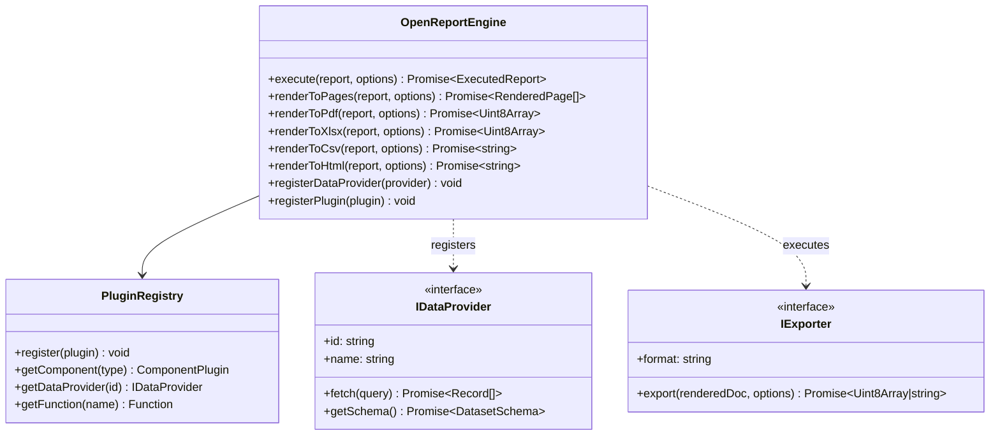

# OpenReport TypeScript API Reference

This document provides complete API reference documentation for the core classes, functions, and interfaces across the `@openreport/*` packages.

---

### Figure 6.1: Core Engine API Architecture & Class Hierarchy



---

## 1. `@openreport/core`

### `OpenReportEngine`
The primary orchestration facade for compiling, measuring, paginating, and exporting reports.

```typescript
import { OpenReportEngine } from '@openreport/core';

const engine = new OpenReportEngine(config?: EngineConfig);
```

#### Methods

##### `execute(report: ReportDefinition, options?: ExecutionOptions): Promise<ExecutedReport>`
Executes dataset queries, binds parameters, and computes expression evaluations across all bands and components.
- **Parameters**:
  - `report: ReportDefinition`: Validated report specification.
  - `options?: ExecutionOptions`: Execution parameters, tenant context, and cancellation tokens.
- **Returns**: `Promise<ExecutedReport>`: Executed intermediate representation with resolved data.

##### `renderToPages(report: ReportDefinition, options?: ExecutionOptions): Promise<RenderedPage[]>`
Executes data queries and runs the multi-pass layout engine to produce paginated vector bounding boxes.
- **Returns**: `Promise<RenderedPage[]>`: Array of rendered page objects containing positioned visual boxes.

##### `renderToPdf(report: ReportDefinition, options?: ExecutionOptions): Promise<Uint8Array>`
Direct shortcut to execute and export the report as a binary vector PDF document.
- **Returns**: `Promise<Uint8Array>`: Raw PDF bytes.

##### `renderToXlsx(report: ReportDefinition, options?: ExecutionOptions): Promise<Uint8Array>`
Direct shortcut to execute and export the report as an Excel spreadsheet with styled worksheets and native column widths.
- **Returns**: `Promise<Uint8Array>`: Raw XLSX bytes.

##### `renderToCsv(report: ReportDefinition, options?: ExecutionOptions): Promise<string>`
Direct shortcut to execute and export tabular datasets as an RFC-4180 CSV string with formula injection protection.
- **Returns**: `Promise<string>`: Sanitized CSV text.

##### `renderToHtml(report: ReportDefinition, options?: ExecutionOptions): Promise<string>`
Exports the report as self-contained semantic HTML with inline CSS and `@media print` rules.
- **Returns**: `Promise<string>`: Standalone HTML document.

##### `registerDataProvider(provider: IDataProvider): void`
Registers a custom data provider (e.g., PostgreSQL, Snowflake, GraphQL).

##### `registerPlugin(plugin: OpenReportPlugin): void`
Registers a plugin extension (custom component renderer, export target, or expression function).

---

## 2. `@openreport/schema`

### Validation & Migration Functions

#### `validateReportDefinition(spec: unknown): DiagnosticReport`
Performs comprehensive structural, type, and semantic validation on a report definition object.
```typescript
import { validateReportDefinition } from '@openreport/schema';

const diagnostics = validateReportDefinition(inputJson);
if (!diagnostics.valid) {
  console.error("Validation errors:", diagnostics.errors);
}
```

#### `migrateReportDefinition(spec: any): ReportDefinition`
Migrates older specification versions up to the current schema specification (`v1.0.0`).

---

## 3. `@openreport/exporters`

### `PdfExporter`
Exports rendered document pages to binary PDF format using `pdf-lib`.
```typescript
import { PdfExporter } from '@openreport/exporters';

const exporter = new PdfExporter();
const pdfBytes: Uint8Array = await exporter.export(pages, reportDefinition);
```

### `XlsxExporter`
Exports report tables and summary data to multi-sheet Excel files using `exceljs`.
```typescript
import { XlsxExporter } from '@openreport/exporters';

const exporter = new XlsxExporter();
const xlsxBytes: Uint8Array = await exporter.export(executedReport);
```

### `CsvExporter`
Exports dataset tables to CSV format, automatically escaping values and prefixing formula injection triggers (`=`, `+`, `-`, `@`, `\t`, `\r`) with single apostrophes.
```typescript
import { CsvExporter } from '@openreport/exporters';

const exporter = new CsvExporter();
const csvText: string = exporter.export(dataset);
```

---

## 4. `@openreport/dashboard`

### `DashboardEngine`
Executes multi-dimensional cross-filtering and aggregate computations across interactive dashboard cards.

```typescript
import { DashboardEngine } from '@openreport/dashboard';

const engine = new DashboardEngine(dashboardDefinition);

// Apply interactive user filter from a chart slice selection
engine.applyFilter('category_filter', {
  field: 'region',
  operator: 'equals',
  value: 'North America'
});

// Retrieve filtered metric card states
const computedCards = engine.computeCards();
```

---

## 5. Embeddable React Components

### `<ReportViewer />` (`@openreport/viewer-react`)
```tsx
import { ReportViewer } from '@openreport/viewer-react';

<ReportViewer
  report={reportDefinition}
  parameters={{ tenantId: '123' }}
  showToolbar={true}
  onExport={(format, data) => console.log(`Exported ${format}`)}
/>
```

### `<ReportDesigner />` (`@openreport/designer-react`)
```tsx
import { ReportDesigner } from '@openreport/designer-react';

<ReportDesigner
  initialReport={reportDefinition}
  onChange={(updatedReport) => saveToDatabase(updatedReport)}
  availableDataSources={['orders', 'customers']}
/>
```
