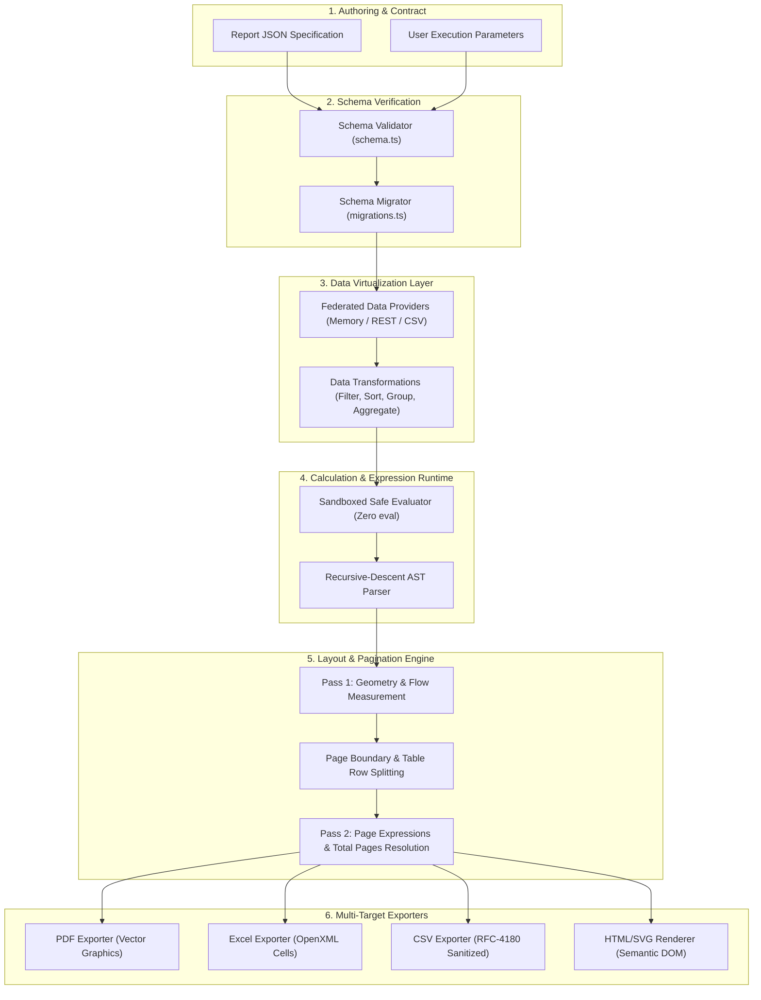
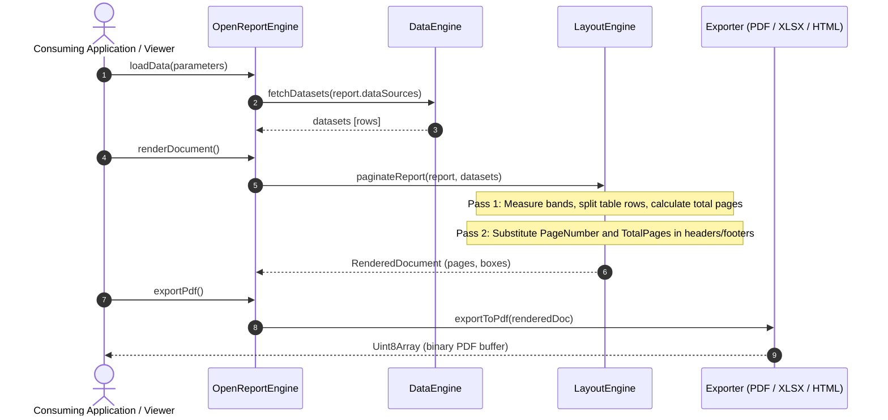

# OpenReport System Architecture

## 1. High-Level Architecture Overview

OpenReport follows a clean, decoupled, layered pipeline architecture:

```
┌─────────────────────────────────────────────────────────────────────────────┐
│                           Authoring & Embedding                             │
│  ┌─────────────────────────┐  ┌───────────────────────┐  ┌───────────────┐  │
│  │ OpenReport Studio (App) │  │ React Designer/Viewer │  │ CLI Tool      │  │
│  └────────────┬────────────┘  └───────────┬───────────┘  └───────┬───────┘  │
└───────────────┼───────────────────────────┼──────────────────────┼──────────┘
                │                           │                      │
┌───────────────▼───────────────────────────▼──────────────────────▼──────────┐
│                             OpenReport Core Facade                          │
│                                (packages/core)                              │
└───────┬───────────────────────────┬──────────────────────────────┬──────────┘
        │                           │                              │
┌───────▼───────────────┐   ┌───────▼───────────────┐   ┌──────────▼──────────┐
│   Report Schema &     │   │     Data Engine &     │   │ Safe Expressions &  │
│   Validation System   │   │     Providers         │   │ Calculation Runtime │
│   (packages/schema)   │   │ (packages/data-engine)│   │(packages/expressions│
└───────┬───────────────┘   └───────┬───────────────┘   └──────────┬──────────┘
        │                           │                              │
        └───────────────────────────┼──────────────────────────────┘
                                    │
                        ┌───────────▼───────────┐
                        │ Layout & Multi-Pass   │
                        │ Pagination Engine     │
                        │(packages/layout-engine│
                        └───────────┬───────────┘
                                    │ Evaluated Document Model (Pages & Boxes)
        ┌───────────────────────────┼──────────────────────────────┐
        │                           │                              │
┌───────▼───────────────┐   ┌───────▼───────────────┐   ┌──────────▼──────────┐
│     PDF Exporter      │   │     Excel Exporter    │   │ CSV / HTML / SVG    │
│  (Pure JS, pdf-lib)   │   │   (OpenXML / exceljs) │   │ Exporters & Viewer  │
└───────────────────────┘   └───────────────────────┘   └─────────────────────┘
```

### Figure 1.1: System Data Flow & Pipeline Architecture



### Figure 1.2: Two-Pass Pagination Sequence



## 2. Core Subsystems

### 2.1 Universal Report Specification (`packages/schema`)
- Standardized, declarative JSON structure (`ReportDefinition`).
- Type-safe schema validator with actionable, element-specific diagnostic errors.
- Schema versioning and migration engine (`v1.0.0` to future versions).
- Definition of page geometry, bands (Report Header/Footer, Page Header/Footer, Group Header/Footer, Detail), component hierarchy, datasets, parameters, and style tokens.

### 2.2 Expression & Calculation Engine (`packages/expressions`)
- Safe Lexer and Recursive-Descent AST Parser.
- AST nodes: BinaryOp, UnaryOp, FunctionCall, MemberAccess, FieldRef (`[Field]`), ParamRef (`?Param`), Literal.
- Evaluator with strictly sandboxed environment—NO `eval` or `Function()`.
- Built-in library:
  - Aggregations: `SUM`, `AVG`, `COUNT`, `MIN`, `MAX`, `FIRST`, `LAST`.
  - Math: `ROUND`, `FLOOR`, `CEIL`, `ABS`, `CLAMP`, `PERCENT`.
  - Text: `UPPER`, `LOWER`, `CONCAT`, `SUBSTRING`, `TRIM`, `REPLACE`, `FORMAT`.
  - Date/Time: `NOW`, `TODAY`, `DATEADD`, `DATEDIFF`, `FORMATDATE`, `YEAR`, `MONTH`, `DAY`.
  - Logic: `IF`, `COALESCE`, `SWITCH`, `ISNULL`, `ISBLANK`.
- Formatter: standard locale-aware currency, percentage, decimal, and date string formatting.

### 2.3 Data Engine & Federated Providers (`packages/data-engine`)
- Neutral Provider Interface:
  - `MemoryDataProvider`: in-memory JS array data.
  - `JsonDataProvider`: raw or URL-fetched JSON documents.
  - `CsvDataProvider`: RFC-4180 compliant CSV parser with type inference.
  - `RestApiDataProvider`: secure authenticated HTTP fetching with parameter interpolation.
- Query Transformation Pipeline:
  - Filter evaluation via expressions.
  - Multi-column sorting (Ascending/Descending, nulls first/last).
  - Grouping by expressions with hierarchical grouping support.
  - Group-level and global aggregations.
  - Calculated fields computed dynamically on row iteration.

### 2.4 Layout & Multi-Pass Pagination Engine (`packages/layout-engine`)
- Band Model:
  1. `ReportHeader` (printed once at the start).
  2. `PageHeader` (printed at top of every page).
  3. `GroupHeader` (printed at start of each group break, optionally repeated on every page).
  4. `Detail` (repeated for each data row).
  5. `GroupFooter` (printed at group end, with subtotal summaries).
  6. `ReportFooter` (printed before page footer at end of report).
  7. `PageFooter` (printed at bottom of every page).
- Measurement System:
  - Abstract point unit (pt) base: `1 in = 72 pt`, `1 mm = 2.83465 pt`, `1 px = 0.75 pt` (at 96 DPI).
  - Exact text bounding box calculations and wrapping.
  - Keep-together rules to prevent orphaned headers or split rows.
- Two-Pass Layout:
  - Pass 1: Measure and compute page allocation, calculate `TotalPages`.
  - Pass 2: Resolve page-dependent expressions (e.g. `"Page " + PageNumber + " of " + TotalPages`) and output layout tree (`RenderedDocument`).

### 2.5 Multi-Target Exporters (`packages/exporters`)
- **PDF**: Generates compliant, multi-page PDF documents with vector text, lines, rectangles, background fills, images, and embedded font metrics.
- **Excel (XLSX)**: Produces formatted spreadsheets with typed numbers, dates, currency formats, column widths, and cell borders.
- **CSV**: RFC-4180 compliant delimited output with delimiter configuration, double-quote escaping, and automated CSV formula-injection mitigation (`=`, `+`, `-`, `@` sanitization).
- **HTML / SVG**: Standalone, responsive semantic HTML and scalable vector graphics for embedding and instant printing.

### 2.6 Visual Designer (`packages/designer-react`)
- Visual drag-and-drop workspace with interactive rulers, snapping guidelines, multi-selection, and resize handles.
- Real-time two-way synchronization with the underlying report JSON schema.
- Interactive property inspector with data-binding selector, typography, borders, and conditional format rules.
- Undo/redo history stack, copy/paste, layer reordering, and element grouping.

### 2.7 Interactive Viewer (`packages/viewer-react`)
- Multi-page and continuous view modes with pinch/slider zoom (25% to 500%), fit-to-width, and fit-to-page.
- Live interactive parameter panel allowing users to re-filter and re-query on the fly.
- Document outline, full-text search with highlight, and one-click direct export to PDF, Excel, and CSV.

### 2.8 Business Intelligence & Dashboards (`packages/dashboard`)
- Unified dashboard definition model supporting responsive multi-column grid layouts.
- Interactive widgets: KPI Cards, Bar Charts, Line Charts, Area Charts, Donut/Pie Charts, and Data Grids.
- Cross-filtering bus: clicking a category in one widget dynamically filters all dependent widgets.
