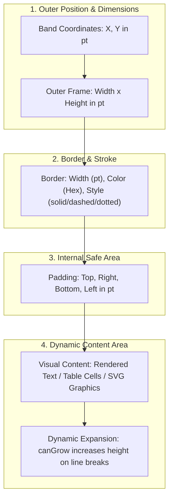
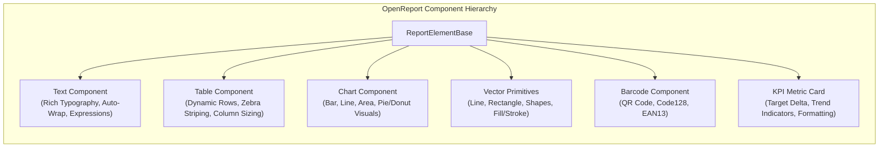

# OpenReport Components Reference

OpenReport provides a modular, extensible component model. Every visual element placed in a band implements a standardized base interface and is measured, positioned, and rendered deterministically across web, PDF, SVG, and HTML.

---

## 1. Common Element Properties

All report elements inherit the following foundational attributes:

### Figure 5.1: Element Box Model & Geometry Hierarchy

```
┌─────────────────────────────────────────────────────────────┐
│ Outer Bounding Box (x, y) pt                                │
│  ┌───────────────────────────────────────────────────────┐  │
│  │ Border (borderColor, borderWidth)                     │  │
│  │  ┌─────────────────────────────────────────────────┐  │  │
│  │  │ Padding (top, right, bottom, left) pt           │  │  │
│  │  │  ┌───────────────────────────────────────────┐  │  │  │
│  │  │  │ Content Area: Text / Table Cells / Charts │  │  │  │
│  │  │  │ (canGrow: auto-expands height if needed)  │  │  │  │
│  │  │  └───────────────────────────────────────────┘  │  │  │
│  │  └─────────────────────────────────────────────────┘  │  │
│  └───────────────────────────────────────────────────────┘  │
└─────────────────────────────────────────────────────────────┘
```



---

### Figure 5.2: Component Taxonomy & Capabilities Matrix



```typescript
interface ReportElementBase {
  id: string;               // Unique element identifier (e.g., "txt_company_name")
  type: ElementType;        // Component type discriminator
  x: number;                // Horizontal position in points (pt) relative to parent band
  y: number;                // Vertical position in points (pt) relative to parent band
  width: number;            // Element width in points (pt)
  height: number;           // Default element height in points (pt)
  canGrow?: boolean;        // Allows dynamic vertical expansion when content exceeds height
  canShrink?: boolean;      // Allows shrinking when content is smaller
  style?: ElementStyle;     // Typography, borders, fills, and padding
  visible?: boolean | string; // Boolean or expression evaluated at render time
}
```

### Element Style Attributes

| Attribute | Type | Description | Default |
|---|---|---|---|
| `fontFamily` | `string` | Font family (`Helvetica`, `Times-Roman`, `Courier`, system font) | `"Helvetica"` |
| `fontSize` | `number` | Font size in points (pt) | `10` |
| `fontWeight` | `"normal" \| "bold"` | Font weight | `"normal"` |
| `fontStyle` | `"normal" \| "italic"` | Font style | `"normal"` |
| `color` | `string` | Hex or CSS color string (e.g., `"#0f172a"`) | `"#000000"` |
| `backgroundColor` | `string` | Background fill color | `undefined` (transparent) |
| `textAlign` | `"left" \| "center" \| "right" \| "justify"` | Horizontal text alignment | `"left"` |
| `borderWidth` | `number` | Border stroke width in points | `0` |
| `borderColor` | `string` | Border stroke color | `"#cbd5e1"` |
| `borderStyle` | `"solid" \| "dashed" \| "dotted"` | Border stroke style | `"solid"` |
| `padding` | `number \| { top, right, bottom, left }` | Internal box padding in points | `0` |

---

## 2. Component Catalog

### `TextElement` (`type: "text"`)
Renders static text, data-bound fields, or complex evaluated expressions with automatic word wrapping.

#### Specific Properties:
- `text: string`: The content to render. If prefixed with `=`, it is evaluated as an expression.
- `wordWrap?: boolean`: Whether to wrap long text into multiple lines (default: `true`).

#### Example Definition:
```json
{
  "id": "invoice_total",
  "type": "text",
  "x": 380,
  "y": 10,
  "width": 160,
  "height": 20,
  "text": "=\"Total Due: \" & FORMAT_CURRENCY(SUM(dataset.items.total), \"USD\")",
  "style": {
    "fontSize": 14,
    "fontWeight": "bold",
    "color": "#1e293b",
    "textAlign": "right"
  }
}
```

---

### `TableElement` (`type: "table"`)
A multi-column dynamic data table bound to a dataset query. Handles row iteration, column-specific formatting, cell wrapping, repeating headers across page splits, and zebra striping.

#### Specific Properties:
- `dataset: string`: Name of the dataset to iterate over.
- `repeatHeaderOnEveryPage?: boolean`: When `true`, automatically prints table headers at the top of subsequent pages when rows span across page boundaries.
- `columns: TableColumn[]`: Column definitions.

#### Column Definition (`TableColumn`):
```typescript
interface TableColumn {
  id: string;
  header: string;           // Column header title
  binding: string;          // Field name or expression (e.g., "unitPrice" or "=\"$\" + price")
  width: number;            // Fixed width in points (pt)
  align?: "left" | "center" | "right";
  format?: string;          // Optional format mask (e.g., "currency", "date")
  style?: ElementStyle;     // Custom styling for this column
}
```

#### Example Definition:
```json
{
  "id": "items_table",
  "type": "table",
  "x": 36,
  "y": 140,
  "width": 540,
  "height": 24,
  "dataset": "items",
  "repeatHeaderOnEveryPage": true,
  "columns": [
    { "id": "col_sku", "header": "SKU", "binding": "sku", "width": 80 },
    { "id": "col_desc", "header": "Description", "binding": "description", "width": 260 },
    { "id": "col_qty", "header": "Qty", "binding": "quantity", "width": 60, "align": "center" },
    { "id": "col_price", "header": "Unit Price", "binding": "unitPrice", "width": 70, "align": "right", "format": "currency" },
    { "id": "col_total", "header": "Total", "binding": "total", "width": 70, "align": "right", "format": "currency" }
  ]
}
```

---

### `KpiElement` (`type: "kpi"`)
A specialized executive KPI metric card displaying a primary metric, supporting caption, and trend delta indicator.

#### Specific Properties:
- `title: string`: Label displayed at the top of the card.
- `value: string`: Primary metric value or formula expression (e.g., `="\"$\" + FORMAT_CURRENCY(SUM(...))"`).
- `delta?: string`: Secondary trend metric (e.g., `"+14.2% vs last month"`).
- `trend?: "up" | "down" | "neutral"`: Color-codes the trend badge (green, red, or slate).

#### Example Definition:
```json
{
  "id": "kpi_mrr",
  "type": "kpi",
  "x": 36,
  "y": 10,
  "width": 170,
  "height": 68,
  "title": "Monthly Recurring Revenue",
  "value": "=\"$\" & FORMAT_CURRENCY(dataset.metrics.mrr, \"USD\")",
  "delta": "+18.4% YoY",
  "trend": "up",
  "style": {
    "backgroundColor": "#f8fafc",
    "borderColor": "#e2e8f0",
    "borderWidth": 1
  }
}
```

---

### `BarcodeElement` (`type: "barcode"`)
Generates vector-accurate 1D barcodes and 2D QR codes without external cloud service dependencies.

#### Specific Properties:
- `barcodeType: "code128" | "qr"`: Barcode symbology.
- `value: string`: Content to encode (or dynamic expression).
- `showText?: boolean`: For 1D barcodes, whether to display human-readable text below the bars.

#### Symbology Capabilities:
1. **Code 128 (1D)**:
   - High-density alphanumeric barcode standard (ISO/IEC 15417).
   - Generates alternating black and white bars with start/stop characters and modulo-103 checksums.
2. **QR Code (2D)**:
   - 2D matrix symbology (ISO/IEC 18004).
   - Generates position finder squares, timing patterns, and error correction modules.
   - Vector-rendered in PDF as crisp vector rectangles (no pixelation at print scale).

#### Example Definition:
```json
{
  "id": "invoice_qr",
  "type": "barcode",
  "x": 480,
  "y": 20,
  "width": 70,
  "height": 70,
  "barcodeType": "qr",
  "value": "https://pay.example.com/inv/908234"
}
```

---

### `ChartElement` (`type: "chart"`)
Renders analytical charts (bar, line, area, pie, doughnut) bound to dataset queries.

#### Specific Properties:
- `chartType: "bar" | "line" | "pie" | "doughnut" | "area"`: Visualization type.
- `dataset: string`: Data source name.
- `categoryField: string`: Field used for X-axis labels or slice categories.
- `valueField: string`: Numeric field used for values/magnitudes.
- `seriesName?: string`: Legend label for the primary series.
- `palette?: string[]`: Hex color codes for chart series.

#### Example Definition:
```json
{
  "id": "sales_by_region",
  "type": "chart",
  "x": 36,
  "y": 90,
  "width": 540,
  "height": 180,
  "chartType": "bar",
  "dataset": "regionalSales",
  "categoryField": "region",
  "valueField": "revenue",
  "seriesName": "Regional Revenue"
}
```

---

### `ShapeElement` & `LineElement` (`type: "shape"`, `type: "line"`)
Draws vector dividers, decorative bands, frames, and background panels.

#### Properties:
- `shapeType: "rectangle" | "line" | "ellipse"`
- `orientation?: "horizontal" | "vertical"` (for lines)
- `style.backgroundColor`: Fill color
- `style.borderColor`: Border/line color
- `style.borderWidth`: Border/line thickness in points
