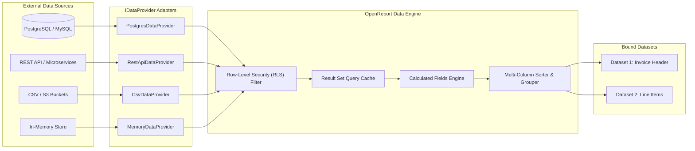

# OpenReport Data Engine & Custom Providers

The OpenReport Data Engine (`@openreport/data-engine`) is a federated data access and query virtualization layer. It decouples the visual document model from specific databases or backend services, allowing reports to query in-memory arrays, REST APIs, JSON/CSV files, or enterprise SQL data warehouses through a single unified interface.

---

## Data Pipeline Architecture

### Figure 3.1: Federated Query Virtualization Pipeline



---

## 1. The `IDataProvider` Interface

Every data provider implements the `IDataProvider` interface:

```typescript
export interface DataQuery {
  datasetName: string;
  source?: string;
  fields?: string[];
  filter?: FilterRule[];
  sort?: SortRule[];
  limit?: number;
  offset?: number;
  parameters?: Record<string, any>;
}

export interface IDataProvider {
  readonly id: string;
  readonly name: string;
  readonly type: string;

  /**
   * Validates configuration and tests data source connectivity.
   */
  testConnection(): Promise<boolean>;

  /**
   * Executes the query and returns an array of homogeneous records.
   */
  fetch(query: DataQuery): Promise<Record<string, any>[]>;

  /**
   * Optional schema introspection for designer autocompletion.
   */
  getSchema?(): Promise<Record<string, { type: string; nullable: boolean }>>;
}
```

---

## 2. Built-in Data Providers

OpenReport ships with four core providers ready to use out of the box:

### 1. `MemoryDataProvider`
Stores static or in-memory JavaScript objects/arrays.
```typescript
import { MemoryDataProvider } from '@openreport/data-engine';

const provider = new MemoryDataProvider('salesData', [
  { id: 1, customer: 'Acme Corp', revenue: 45000, region: 'North' },
  { id: 2, customer: 'Globex Ltd', revenue: 82000, region: 'East' }
]);
```

### 2. `JsonDataProvider`
Loads data from a local JSON file path or a remote HTTP(S) endpoint.
```typescript
import { JsonDataProvider } from '@openreport/data-engine';

const provider = new JsonDataProvider('remoteCustomers', {
  url: 'https://api.example.com/v1/customers',
  headers: { Authorization: 'Bearer YOUR_TOKEN' },
  dataPath: 'data.items' // Optional JSON path navigation
});
```

### 3. `CsvDataProvider`
Parses CSV data with full RFC-4180 compliance (escaped quotes, commas inside strings, multi-line values, automatic type inference for numbers and booleans).
```typescript
import { CsvDataProvider } from '@openreport/data-engine';

const provider = new CsvDataProvider('historicalData', {
  csvContent: `sku,description,unitPrice,inStock\nSKU-100,"Pro Widget",49.99,true\nSKU-200,"Basic Gadget",19.99,false`
});
```

### 4. `RestApiDataProvider`
Executes parameterized REST requests, passing report parameters as query parameters or POST body JSON payloads.

---

## 3. Implementing a Custom SQL Data Provider (PostgreSQL / MySQL)

To connect OpenReport directly to PostgreSQL, MySQL, Snowflake, or SQLite, implement `IDataProvider`:

```typescript
import { IDataProvider, DataQuery } from '@openreport/data-engine';
import { Pool } from 'pg'; // Standard pg client

export class PostgresDataProvider implements IDataProvider {
  readonly id: string;
  readonly name: string;
  readonly type = 'postgresql';
  private pool: Pool;

  constructor(id: string, name: string, connectionString: string) {
    this.id = id;
    this.name = name;
    this.pool = new Pool({ connectionString });
  }

  async testConnection(): Promise<boolean> {
    const res = await this.pool.query('SELECT 1');
    return res.rowCount !== null && res.rowCount > 0;
  }

  async fetch(query: DataQuery): Promise<Record<string, any>[]> {
    const { datasetName, parameters, limit, offset } = query;

    // Parameterized SQL query with tenant-level Row-Level Security (RLS)
    const sql = `
      SELECT id, order_date, customer_name, total_amount, status
      FROM orders
      WHERE tenant_id = $1
        AND order_date >= $2
        AND order_date <= $3
      ORDER BY order_date DESC
      LIMIT $4 OFFSET $5
    `;

    const values = [
      parameters?.tenantId,
      parameters?.startDate || '2026-01-01',
      parameters?.endDate || '2026-12-31',
      limit || 500,
      offset || 0
    ];

    const result = await this.pool.query(sql, values);
    return result.rows;
  }

  async getSchema() {
    return {
      id: { type: 'number', nullable: false },
      order_date: { type: 'string', nullable: false },
      customer_name: { type: 'string', nullable: false },
      total_amount: { type: 'number', nullable: false },
      status: { type: 'string', nullable: false }
    };
  }
}
```

---

## 4. Registering Providers with the Engine

Register custom data providers into the OpenReport execution pipeline:

```typescript
import { OpenReportEngine } from '@openreport/core';
import { PostgresDataProvider } from './PostgresDataProvider';

const engine = new OpenReportEngine();

// Register the provider
engine.registerDataProvider(
  new PostgresDataProvider('db_primary', 'Production Database', process.env.DATABASE_URL!)
);

// Render report with execution parameters
const pdfBuffer = await engine.renderToPdf(reportDefinition, {
  parameters: {
    tenantId: 'cust_89234',
    startDate: '2026-01-01',
    endDate: '2026-10-28'
  }
});
```

---

## 5. Security & Multi-Tenancy Best Practices

1. **Strict Parameter Sanitization**: Never concatenate user parameters into raw SQL strings. Always use parameterized queries (`$1`, `$2` or `?`).
2. **Mandatory Tenant Scoping**: Ensure every query injected with user parameters includes the active authenticated tenant identifier (`tenant_id = $1`).
3. **Query Timeouts**: Configure database connection pools with strict socket timeouts (e.g., `statement_timeout = 10000ms`) to protect against resource exhaustion.
4. **Memory Guardrails**: Use `limit` constraints on `DataQuery` to prevent fetching millions of rows into node memory simultaneously.
