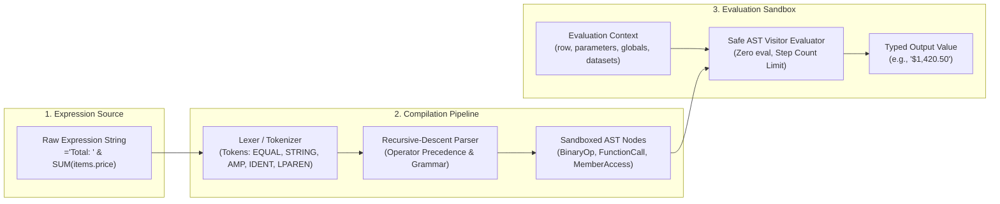
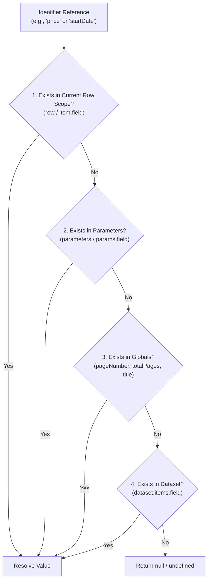

# OpenReport Expression Engine Reference

The OpenReport expression engine (`@openreport/expressions`) provides a zero-`eval()`, sandboxed, deterministic mathematical and functional expression evaluator. It compiles expressions into an Abstract Syntax Tree (AST) using a formal Lexer and Recursive Descent Parser, executing against report parameters, dataset rows, and execution metadata without any arbitrary code execution risk.

---

### Figure 10.1: Expression Engine Lexing, Parsing & Evaluation Pipeline



---

## 1. Syntax Basics

Expressions start with an equals sign `=` when used inside report component properties or text fields:

```text
="Subtotal: " & FORMAT_CURRENCY(SUM(dataset.items.total), "USD")
```

### Supported Literals
- **Strings**: Double-quoted strings with escape sequences (e.g., `"Hello \"World\""`, `"Line 1\nLine 2"`).
- **Numbers**: Integers and floating-point values (e.g., `42`, `3.14159`, `-10`).
- **Booleans**: `true`, `false`.
- **Null**: `null`.

### Operators

| Operator | Type | Description | Example |
|---|---|---|---|
| `+` | Arithmetic / Concatenation | Addition for numbers, string concatenation for strings | `price + tax`, `"Hello " + name` |
| `-` | Arithmetic | Subtraction or unary negation | `total - discount`, `-margin` |
| `*` | Arithmetic | Multiplication | `quantity * unitPrice` |
| `/` | Arithmetic | Division (returns `0` if divided by zero to prevent runtime crashes) | `revenue / count` |
| `%` | Arithmetic | Modulo (remainder) | `row_index % 2` |
| `&` | Concatenation | Explicit string concatenation (coerces operands to string) | `"Total: " & total` |
| `==` | Comparison | Equality check | `status == "Shipped"` |
| `!=` | Comparison | Inequality check | `category != "Archived"` |
| `<` | Comparison | Less than | `stock < 10` |
| `<=` | Comparison | Less than or equal | `days <= 30` |
| `>` | Comparison | Greater than | `score > 90` |
| `>=` | Comparison | Greater than or equal | `balance >= 0` |
| `&&` | Logical | Logical AND | `isPaid && isDelivered` |
| `\|\|` | Logical | Logical OR | `isRefunded \|\| isCancelled` |
| `!` | Logical | Logical NOT (unary) | `!isActive` |

---

## 2. Context Variables & Scopes

### Figure 10.2: Identifier Scope Precedence Resolution



The expression evaluator resolves identifiers in order of scope precedence:

1. **Row Scope** (`item`, `row`, or direct field references):
   - `item.unitPrice` or `unitPrice`
   - `row.quantity` or `quantity`
2. **Parameters** (`parameters.<name>` or `params.<name>`):
   - `parameters.startDate`
   - `parameters.currencyCode`
3. **Globals** (`globals.<name>`):
   - `globals.pageNumber`: Current 1-based page number.
   - `globals.totalPages`: Total calculated pages in the document.
   - `globals.executionTime`: ISO timestamp of execution.
   - `globals.reportTitle`: Name of the current report definition.
4. **Data Engine Datasets** (`dataset.<name>.<field>`):
   - `dataset.orders.total` (evaluated as an array in aggregation functions).

---

## 3. Built-in Function Catalog

### Aggregate Functions
Aggregates operate over array fields or dataset collections:

#### `SUM(array)`
Computes the arithmetic sum of all numeric elements in the array.
```text
=SUM(dataset.items.totalAmount)
```

#### `AVG(array)`
Computes the arithmetic mean of all numeric elements.
```text
=AVG(dataset.items.rating)
```

#### `COUNT(array)`
Returns the number of elements in the collection.
```text
=COUNT(dataset.items.id)
```

#### `MIN(array)`
Returns the minimum numerical value in the collection.
```text
=MIN(dataset.items.unitPrice)
```

#### `MAX(array)`
Returns the maximum numerical value in the collection.
```text
=MAX(dataset.items.unitPrice)
```

---

### Formatting Functions

#### `FORMAT_CURRENCY(value, currencyCode?, locale?)`
Formats a numeric value as a localized currency string.
- `currencyCode`: ISO 4217 code (default: `"USD"`).
- `locale`: BCP 47 locale tag (default: `"en-US"`).
```text
=FORMAT_CURRENCY(item.unitPrice, "EUR", "de-DE")
// Returns: "1.234,50 €"
```

#### `FORMAT_PERCENT(value, decimals?)`
Formats a fractional or float value (e.g., `0.15`) as a percentage string.
- `decimals`: Number of fractional digits (default: `1`).
```text
=FORMAT_PERCENT(item.margin, 2)
// Returns: "15.00%"
```

#### `FORMAT_DATE(isoDateString, formatStyle?)`
Formats an ISO 8601 date string or timestamp into human-readable format.
- `formatStyle`: `"short"`, `"medium"`, `"long"`, or `"iso"` (default: `"medium"`).
```text
=FORMAT_DATE(item.orderDate, "short")
// Returns: "10/28/2026"
```

---

### Conditional & Logical Functions

#### `IF(condition, trueValue, falseValue)`
Evaluates the condition and returns `trueValue` if truthy, otherwise `falseValue`.
```text
=IF(item.quantity > 50, "Bulk Discount Applied", "Standard Rate")
```

#### `COALESCE(val1, val2, ...)`
Returns the first non-null, non-undefined argument.
```text
=COALESCE(item.secondaryPhone, item.primaryPhone, "N/A")
```

#### `SWITCH(value, case1, result1, case2, result2, ..., defaultResult)`
Compares `value` against a series of case expressions and returns the matching result.
```text
=SWITCH(
  item.status,
  "PENDING", "Awaiting Approval",
  "APPROVED", "Ready for Dispatch",
  "SHIPPED", "In Transit",
  "Unknown Status"
)
```

---

### String & Text Functions

#### `UPPER(str)` / `LOWER(str)`
Converts text to uppercase or lowercase.
```text
=UPPER(item.sku)
```

#### `TRIM(str)`
Strips leading and trailing whitespace.
```text
=TRIM(item.customerNotes)
```

#### `CONCAT(arg1, arg2, ...)`
Concatenates multiple arguments into a single string.
```text
=CONCAT("INV-", item.id, "-", item.fiscalYear)
```

---

## 4. Security & Safety Properties

1. **Zero `eval()` / Zero `Function()`**: The parser constructs an explicit AST and evaluates it recursively using a strict visitor pattern.
2. **Prototype Pollution Protection**: Property lookups block access to `__proto__`, `constructor`, and `prototype`.
3. **Division by Zero Defense**: `x / 0` evaluates safely to `0` instead of `Infinity` or throwing an exception.
4. **Deterministic Execution**: Expressions do not have side effects and produce identical output for identical state.
