# OpenReport Feature Parity & Benchmark Matrix

This document tracks OpenReport's feature capabilities in comparison to industry-standard enterprise reporting platforms, specifically **DevExpress Reporting**, **Telerik Reporting**, and **JasperReports**.

---

### Figure 7.1: Architectural Evolution: Legacy vs OpenReport

```mermaid
flowchart TD
    subgraph LegacyDevExpress ["DevExpress Reporting (.NET Era)"]
        D_SPEC["Proprietary C# / CodeDOM / XML Definitions"]
        D_RUN[".NET Framework / CLR Server Dependency"]
        D_DES["Desktop WinForms or Heavy ASP.NET Designer"]
        D_LIC["Proprietary Commercial License ($$$ per seat)"]
        D_SPEC --> D_RUN --> D_DES --> D_LIC
    end

    subgraph LegacyJasper ["JasperReports (Java Era)"]
        J_SPEC["Verbose JRXML (Complex XML format)"]
        J_RUN["Java JVM / JasperServer Dependency"]
        J_DES["Eclipse-based JasperSoft Studio"]
        J_LIC["GPL / Dual Commercial Licensing Model"]
        J_SPEC --> J_RUN --> J_DES --> J_LIC
    end

    subgraph OpenReportPlatform ["OpenReport (Modern Developer-First Platform)"]
        O_SPEC["Universal JSON Report Schema (v1.0.0, Portable)"]
        O_RUN["Universal JS/TS Engine (Runs in Browser, Node, Edge)"]
        O_DES["Embeddable Modern React Designer & Viewer"]
        O_LIC["Permissive Apache-2.0 Open-Source License"]
        O_SPEC --> O_RUN --> O_DES --> O_LIC
    end
```

---

| Capability Area | Feature | DevExpress Reporting | JasperReports | OpenReport Status | Notes / Implementation |
|---|---|:---:|:---:|:---:|---|
| **Core Architecture** | Declarative Specification | Proprietary XML/Code | JRXML (XML) | **Native JSON** | Full JSON Schema with TypeScript types & bidirectional validation |
| | Framework Agnostic Core | .NET Only | Java Only | **Yes (Universal)** | Runs in Browser, Node.js, Bun, Edge, or via HTTP API |
| | Zero Server Dependency for Preview | No | No | **Yes** | Client-side layout engine & PDF generation in browser |
| **Document Layout** | Banded Layout Engine | Yes | Yes | **Yes** | Report/Page/Group Headers & Footers, Detail bands |
| | Multi-Pass Pagination | Yes | Yes | **Yes** | Two-pass resolution for `PageNumber` of `TotalPages` |
| | Keep-Together Rules | Yes | Yes | **Yes** | Prevents group header or detail row orphan breaks |
| | Subreports | Yes | Yes | **Yes** | Nested report execution with parameter binding |
| | Dynamic Band Height / Auto-wrap | Yes | Yes | **Yes** | Exact text measurement with line-wrapping calculation |
| **Expressions & Calculation** | Sandboxed Expression Language | C# / VB Script | Groovy / Java | **Yes (Safe AST)** | Custom safe AST parser without `eval()` or code execution |
| | Statistical Aggregations | Yes | Yes | **Yes** | `SUM`, `AVG`, `COUNT`, `MIN`, `MAX`, `RUNNING_SUM`, etc. |
| | Conditional Formatting | Yes | Yes | **Yes** | Expression-driven background, text color, visibility, fonts |
| **Data Engine** | In-Memory Data | Yes | Yes | **Yes** | Native JavaScript array & object binding |
| | JSON & CSV Providers | Yes | Yes | **Yes** | Type-inferred streaming parser with RFC-4180 compliance |
| | REST API / HTTP Provider | Yes | Limited | **Yes** | Auth headers, parameter interpolation, nested JSON path |
| | SQL / Relational Provider | Yes | Yes | **Yes** | Parameterized query provider interface |
| | Client-Side Grouping & Sorting | Yes | Yes | **Yes** | Multi-column sort, multi-level group hierarchy |
| **Visual Designer** | Browser-Based Visual Designer | Web Report Designer (.NET backend) | JasperSoft Studio (Desktop Eclipse) | **Pure Client-Side React** | Full drag-and-drop, snapping grid, property inspector |
| | Interactive Rulers & Guides | Yes | Yes | **Yes** | Precise millimeter & pixel rulers with alignment snapping |
| | Undo / Redo History | Yes | Yes | **Yes** | Deep immutable state history stack |
| | Visual Data Binding | Yes | Yes | **Yes** | Drag fields directly from dataset tree to canvas |
| **Document Viewing** | Multi-Page & Continuous Scrolling | Yes | Yes | **Yes** | Smooth responsive viewer with zoom (25%-500%) |
| | Interactive Parameters | Yes | Yes | **Yes** | Dynamic parameter panel updating report preview in real time |
| | Document Search | Yes | Yes | **Yes** | Full-text search with highlight matches |
| **Export Formats** | High-Fidelity PDF | Yes | Yes | **Yes** | Vector text, borders, images, embedded standard fonts |
| | Native Excel (XLSX) | Yes | Yes | **Yes** | Formatted cells, typed dates/numbers, column sizing |
| | Compliant CSV Export | Yes | Yes | **Yes** | RFC-4180 with CSV Formula Injection protection |
| | HTML & SVG | Yes | Yes | **Yes** | Standalone embeddable HTML and SVG graphics |
| **Business Intelligence** | Dashboards & KPI Cards | Separate Dashboard product | JasperReports Server | **Unified in OpenReport** | Dashboard composer with grid layout & KPI widgets |
| | Interactive Cross-Filtering | Yes (Dashboard) | Limited | **Yes** | Widget interaction dynamically cross-filters dashboard |
| **Security** | Sandboxed Execution | Partial (trust setup) | Partial | **Strict Sandbox** | No arbitrary code execution, query parameterization |
| | CSV Formula Injection Mitigation | Manual config | Manual config | **Enabled by Default** | Sanitizes `=`, `+`, `-`, `@` characters in export |
