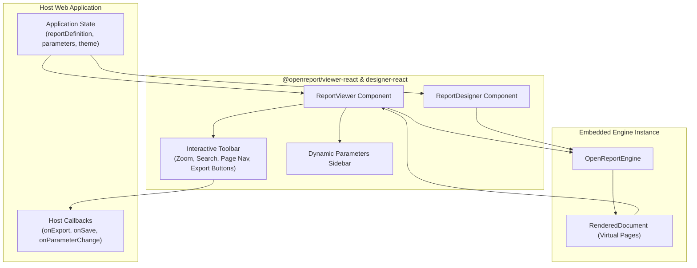

# OpenReport Universal Integration Guide

OpenReport is designed from the core up to be completely framework-agnostic. It can be embedded as a UI component in frontend frameworks or executed headlessly in backend runtimes.

---

## Architectural Integration Topology

### Figure 4.1: Client vs Server Execution Topology

```mermaid
flowchart TD
    subgraph ClientExecution ["Pattern A: Client-Side Embedded (Zero Server Infrastructure)"]
        BROWSER["Web Browser (React / Vue / Angular / Svelte)"]
        ENGINE_C["@openreport/core (WebAssembly / Pure JS)"]
        EXPORT_C["Client PDF / Excel / CSV Generation"]
        BROWSER --> ENGINE_C --> EXPORT_C
    end

    subgraph ServerExecution ["Pattern B: Headless Server / API Gateway (Enterprise High-Throughput)"]
        POLY["Polyglot Backend (Python / Java / Go / .NET)"]
        API["Node.js / Express Microservice / Lambda"]
        ENGINE_S["@openreport/core (Worker Threads)"]
        STORAGE["S3 / GCS Storage Bucket"]
        POLY -->|POST /api/reports/generate| API
        API --> ENGINE_S
        ENGINE_S -->|PDF / XLSX stream| STORAGE
        STORAGE -->|Presigned URL| POLY
    end
```



---

## Table of Contents
1. [React & Next.js Integration](#1-react--nextjs-integration)
2. [Vue 3 & Nuxt Integration](#2-vue-3--nuxt-integration)
3. [Angular Integration](#3-angular-integration)
4. [Vanilla JavaScript Integration](#4-vanilla-javascript-integration)
5. [Node.js & Express REST Backend](#5-nodejs--express-rest-backend)
6. [Python (FastAPI / Django / Flask)](#6-python-fastapi--django--flask)
7. [Go, Java & .NET Services](#7-go-java--net-services)

---

## 1. React & Next.js Integration

### Installation
```bash
npm install @openreport/core @openreport/viewer-react @openreport/designer-react
```

### 1.1 Embedding the Interactive Viewer

### Figure 4.2: Embeddable Component & Engine State Flow



```tsx
import React from 'react';
import { ReportViewer } from '@openreport/viewer-react';
import { CommercialInvoiceTemplate } from '@openreport/core';

export default function InvoiceViewer() {
  return (
    <div style={{ height: '100vh', width: '100%' }}>
      <ReportViewer
        report={CommercialInvoiceTemplate}
        parameters={{
          invoiceNumber: 'INV-2026-8801',
          dueDate: '2026-11-30'
        }}
        onExport={(format, blob) => {
          console.log(`Report exported as ${format}, size: ${blob.size} bytes`);
        }}
      />
    </div>
  );
}
```

### 1.2 Embedding the Visual Drag-and-Drop Designer
```tsx
import React, { useState } from 'react';
import { ReportDesigner } from '@openreport/designer-react';
import { CommercialInvoiceTemplate } from '@openreport/core';
import { ReportDefinition } from '@openreport/schema';

export default function ReportEditorPage() {
  const [report, setReport] = useState<ReportDefinition>(CommercialInvoiceTemplate);

  const handleSaveToServer = async () => {
    await fetch('/api/reports/save', {
      method: 'POST',
      headers: { 'Content-Type': 'application/json' },
      body: JSON.stringify(report)
    });
    alert('Report template saved!');
  };

  return (
    <div>
      <button onClick={handleSaveToServer}>Save Template</button>
      <ReportDesigner report={report} onChange={setReport} />
    </div>
  );
}
```

---

## 2. Vue 3 & Nuxt Integration

OpenReport's core engine runs directly in the browser. You can render paginated reports in Vue using the HTML exporter or vector SVG:

```vue
<template>
  <div class="report-container">
    <div class="toolbar">
      <button @click="exportPdf">Download PDF</button>
      <button @click="exportExcel">Download Excel</button>
    </div>
    <div class="pages-wrapper" v-html="renderedHtml"></div>
  </div>
</template>

<script setup>
import { ref, onMounted } from 'vue';
import { OpenReportEngine, CommercialInvoiceTemplate } from '@openreport/core';

const renderedHtml = ref('');
let engine = null;

onMounted(async () => {
  engine = new OpenReportEngine(CommercialInvoiceTemplate, {
    parameters: { invoiceNumber: 'INV-VUE-001' }
  });
  await engine.loadData();
  renderedHtml.value = await engine.exportHtml();
});

const exportPdf = async () => {
  const buffer = await engine.exportPdf();
  const blob = new Blob([buffer], { type: 'application/pdf' });
  triggerDownload(blob, 'invoice.pdf');
};

const triggerDownload = (blob, filename) => {
  const url = URL.createObjectURL(blob);
  const a = document.createElement('a');
  a.href = url;
  a.download = filename;
  a.click();
  URL.revokeObjectURL(url);
};
</script>
```

---

## 3. Angular Integration

In Angular services or components, inject `OpenReportEngine`:

```typescript
import { Component, OnInit } from '@angular/core';
import { OpenReportEngine, ReportDefinition } from '@openreport/core';

@Component({
  selector: 'app-report-viewer',
  template: `
    <button (click)="downloadPdf()">Download PDF</button>
    <div [innerHTML]="htmlContent"></div>
  `
})
export class ReportViewerComponent implements OnInit {
  htmlContent: string = '';
  private engine!: OpenReportEngine;

  async ngOnInit() {
    this.engine = new OpenReportEngine(myReportDefinition);
    this.htmlContent = await this.engine.exportHtml();
  }

  async downloadPdf() {
    const bytes = await this.engine.exportPdf();
    // Save file via FileSaver or Blob
  }
}
```

---

## 4. Vanilla JavaScript Integration

For non-bundled or legacy applications:

```html
<!DOCTYPE html>
<html>
<head>
  <title>Billing Statement</title>
</head>
<body>
  <button id="btnPdf">Download PDF Statement</button>

  <script type="module">
    import { OpenReportEngine } from 'https://cdn.jsdelivr.net/npm/@openreport/core/dist/index.mjs';

    document.getElementById('btnPdf').addEventListener('click', async () => {
      const template = await (await fetch('/templates/invoice.json')).json();
      const engine = new OpenReportEngine(template);
      const pdfBytes = await engine.exportPdf();
      
      const blob = new Blob([pdfBytes], { type: 'application/pdf' });
      const url = URL.createObjectURL(blob);
      window.open(url, '_blank');
    });
  </script>
</body>
</html>
```

---

## 5. Node.js & Express REST Backend

Run OpenReport on the server to generate documents asynchronously in background jobs, cron tasks, or microservice APIs:

```javascript
const express = require('express');
const { OpenReportEngine, CommercialInvoiceTemplate } = require('@openreport/core');

const app = express();
app.use(express.json());

// Endpoint to stream a PDF
app.get('/api/invoices/:id/pdf', async (req, res) => {
  try {
    const engine = new OpenReportEngine(CommercialInvoiceTemplate, {
      parameters: { invoiceNumber: req.params.id }
    });

    const pdfBuffer = await engine.exportPdf();

    res.setHeader('Content-Type', 'application/pdf');
    res.setHeader('Content-Disposition', `attachment; filename="${req.params.id}.pdf"`);
    res.send(Buffer.from(pdfBuffer));
  } catch (err) {
    res.status(500).json({ error: err.message });
  }
});

// Endpoint to stream Excel
app.get('/api/reports/sales/xlsx', async (req, res) => {
  const engine = new OpenReportEngine(ExecutiveSalesReportTemplate);
  const xlsxBuffer = await engine.exportXlsx();

  res.setHeader('Content-Type', 'application/vnd.openxmlformats-officedocument.spreadsheetml.sheet');
  res.setHeader('Content-Disposition', 'attachment; filename="sales.xlsx"');
  res.send(Buffer.from(xlsxBuffer));
});

app.listen(4000, () => console.log('Report API running on port 4000'));
```

---

## 6. Python (FastAPI / Django / Flask)

Python applications can integrate with OpenReport in two ways:

### Pattern A: Calling the Node CLI
```python
import subprocess
import json

def generate_report_pdf(report_json_path: str, output_pdf_path: str):
    subprocess.run([
        "openreport", "export", report_json_path,
        "--format", "pdf",
        "--output", output_pdf_path
    ], check=True)
```

### Pattern B: Calling the OpenReport HTTP Microservice
```python
import requests

def fetch_invoice_pdf(invoice_number: str) -> bytes:
    response = requests.get(
        f"http://reporting-service:4000/api/invoices/{invoice_number}/pdf"
    )
    response.raise_for_status()
    return response.content
```

---

## 7. Go, Java & .NET Services

Because the OpenReport specification is pure JSON (`report.schema.json`), your Go, Java, or C# services can easily:
1. Construct the declarative report definition using standard serialization structs.
2. Dispatch the payload to a headless OpenReport container or CLI.
3. Receive the byte stream of the generated PDF or Excel workbook.
