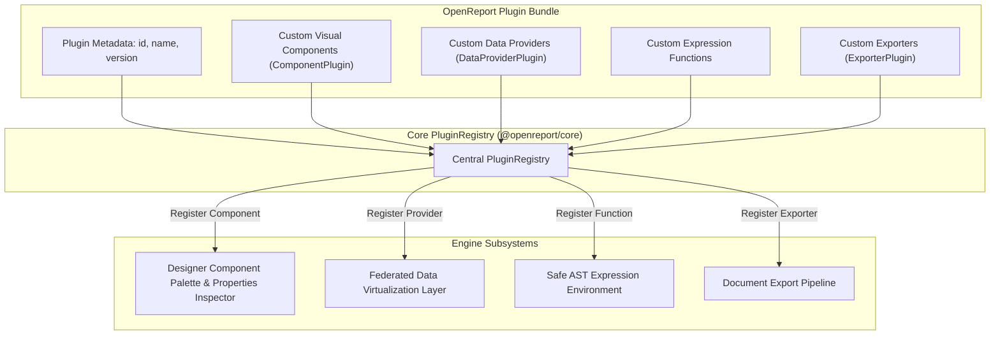

# OpenReport Plugin Development Guide

OpenReport is designed with an extensible plugin architecture, allowing developers to introduce custom components, proprietary data providers, specialized chart visualizers, and export formatters.

---

### Figure 11.1: Plugin Extension Points & Lifecycle Architecture



---

## 1. Plugin Architecture

An OpenReport plugin registers with the central `PluginRegistry`:

```typescript
import { PluginRegistry, ComponentPlugin, DataProviderPlugin } from '@openreport/core';

export interface OpenReportPlugin {
  id: string;
  name: string;
  version: string;
  components?: ComponentPlugin[];
  dataProviders?: DataProviderPlugin[];
  customFunctions?: Record<string, (...args: any[]) => any>;
}
```

## 2. Registering Custom Components

To register a custom report component (e.g. a 3D Gauge or specialized Heatmap):

```typescript
const GaugeComponentPlugin: ComponentPlugin = {
  type: 'custom.gauge',
  displayName: 'Circular Gauge',
  category: 'Visualization',
  defaultProps: {
    min: 0,
    max: 100,
    value: 50,
    color: '#3b82f6'
  },
  propertyControls: [
    { name: 'value', type: 'expression', label: 'Value' },
    { name: 'max', type: 'number', label: 'Max' },
    { name: 'color', type: 'color', label: 'Color' }
  ],
  render: ({ element, dataContext, measureText }) => {
    // Return layout bounding box and render primitives (svg / canvas / pdf)
  }
};
```

## 3. Registering Custom Data Providers

Custom data providers implement the `IDataProvider` interface:

```typescript
export interface IDataProvider {
  id: string;
  name: string;
  fetch(query: DataQuery, context: ExecutionContext): Promise<DataQueryResult>;
  getSchema?(query: DataQuery): Promise<DatasetSchema>;
}
```
