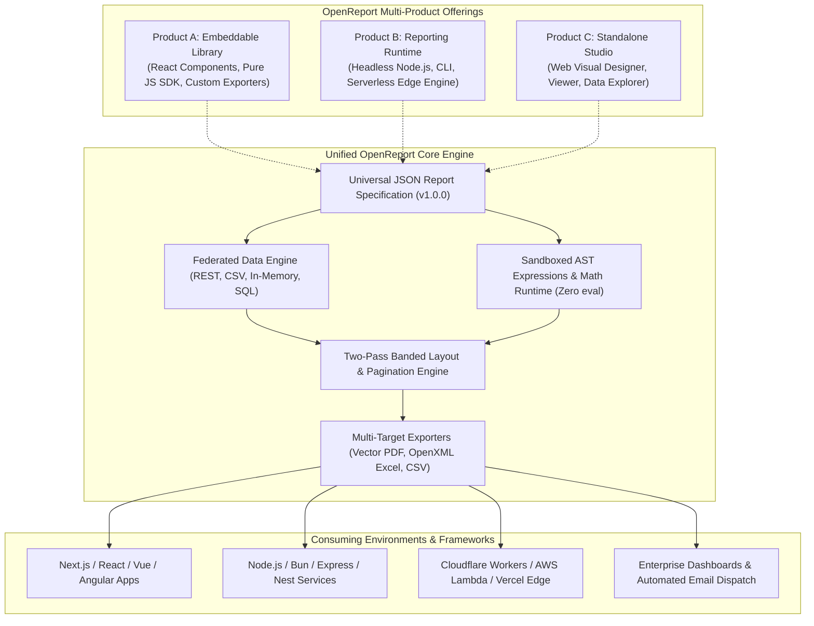
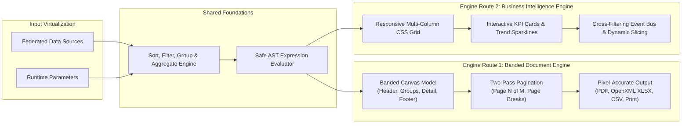

# OpenReport Product Vision

## 1. Executive Summary
**OpenReport** is an enterprise-grade, developer-first, open-source reporting and business intelligence platform. Designed as a modern alternative to legacy enterprise reporting solutions like DevExpress Reporting, Telerik Reporting, and SAP Crystal Reports, OpenReport unites pixel-perfect paginated document authoring, interactive web viewing, advanced data visualization, and dashboard analytics into a single, cohesive, framework-agnostic ecosystem.

---

### Figure 0.1: Universal Reporting Platform Ecosystem & Multi-Product Pillars

---

## 2. Core Pillars

### 2.1 Universal, Portable Specification
A report in OpenReport is defined by a declarative, versioned JSON specification. This specification is decoupled from any UI framework, rendering target, or server platform. It can be authored in a browser, modified programmatically via Node.js, Python, or .NET APIs, and rendered headlessly or client-side.

### 2.2 Dual Engine: Paginated Documents & Interactive Dashboards

---

### Figure 0.2: Dual Engine Architecture: Paginated Documents vs BI Dashboards

---

### 2.3 Sandboxed & Secure Expression Language
Untrusted report definitions must never execute arbitrary code. OpenReport features a custom Abstract Syntax Tree (AST) parser and sandboxed evaluator supporting arithmetic, logical comparisons, date/time functions, string operations, statistical aggregations, and conditional formatting without ever invoking `eval()` or `new Function()`.

### 2.4 Developer-First Embeddability & Modularity
- Zero mandatory server dependencies for browser-based authoring and previewing.
- Rich React components for embedding both the visual Designer and Viewer with full theme and hook support.
- Headless execution engine runnable in any Node.js, Bun, or edge serverless environment.
- Modular architecture where exporters, data providers, and custom chart components can be tree-shaken or dynamically registered.

### 2.5 Data Neutrality & Federation
Connect effortlessly to in-memory datasets, REST APIs, JSON/CSV endpoints, and relational databases. OpenReport provides push-down query optimization, client-side filtering/sorting/grouping, and parameterized query execution with built-in security protections.

---

© OpenReport Contributors. Released under Apache-2.0 License.
