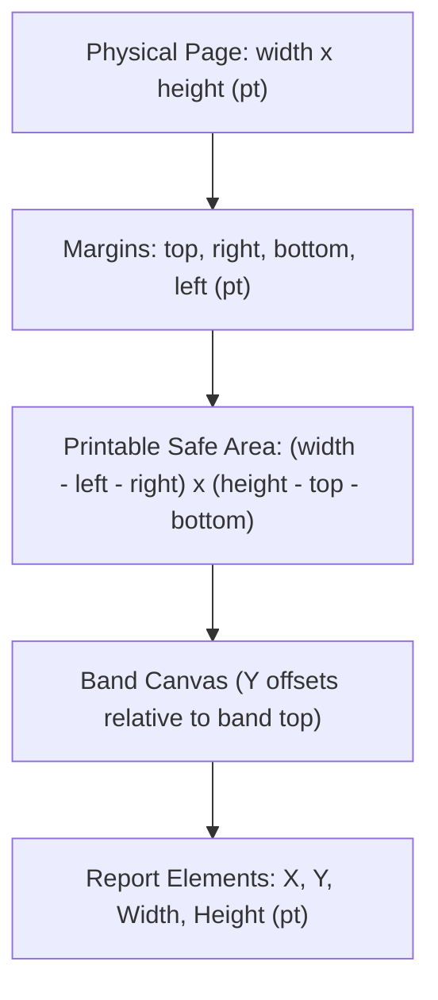
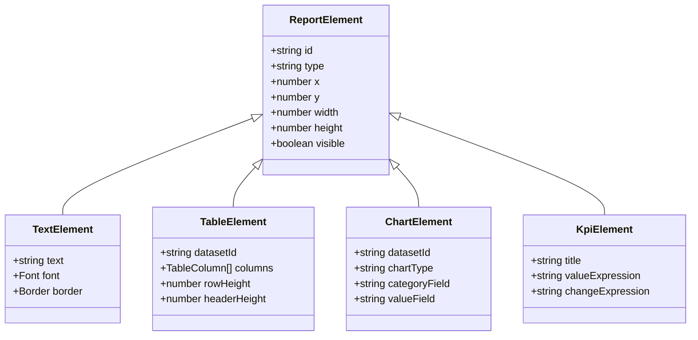

# OpenReport Specification Schema (v1.0.0)

The OpenReport Specification (`ReportDefinition`) is a versioned, portable JSON document defining report structure, page geometry, datasets, parameters, bands, and components.

## Structure Overview

```json
{
  "schemaVersion": "1.0.0",
  "id": "sales-performance-report",
  "title": "Quarterly Sales Performance",
  "description": "Executive revenue summary with regional breakdown",
  "page": {
    "size": "A4",
    "orientation": "portrait",
    "margins": { "top": 36, "right": 36, "bottom": 36, "left": 36 },
    "unit": "pt"
  },
  "parameters": [
    {
      "name": "startDate",
      "type": "date",
      "label": "Start Date",
      "defaultValue": "2026-01-01"
    }
  ],
  "dataSources": [
    {
      "id": "salesData",
      "provider": "memory",
      "data": [ ... ]
    }
  ],
  "datasets": [
    {
      "id": "quarterlySales",
      "dataSourceId": "salesData",
      "filter": "revenue > 1000",
      "sortBy": [{ "field": "revenue", "direction": "desc" }]
    }
  ],
  "bands": {
    "reportHeader": { "height": 80, "elements": [ ... ] },
    "pageHeader": { "height": 40, "elements": [ ... ] },
    "groupHeaders": [ ... ],
    "detail": { "height": 24, "elements": [ ... ] },
    "groupFooters": [ ... ],
    "reportFooter": { "height": 60, "elements": [ ... ] },
    "pageFooter": { "height": 30, "elements": [ ... ] }
  }
}
```

## Supported Standard Page Sizes
- `A4` (595.28 x 841.89 pt)
- `A3` (841.89 x 1190.55 pt)
- `Letter` (612 x 792 pt)
- `Legal` (612 x 1008 pt)
- `Custom` (user-defined width and height)

## Units of Measurement
- `pt` (Points: 72 points per inch)
- `mm` (Millimeters: 1 mm = 2.83465 pt)
- `in` (Inches: 1 in = 72 pt)
- `px` (Pixels: 96 dpi baseline, 1 px = 0.75 pt)

---

## Visual Band Model & Anatomy

### Figure 2.1: Multi-Page Band Printing Hierarchy

```
┌────────────────────────────────────────────────────────┐
│ Page Top Margin                                        │
├────────────────────────────────────────────────────────┤
│ Page Header (Repeats on every page)                    │
├────────────────────────────────────────────────────────┤
│ Report Header (Prints ONCE on Page 1 only)             │
├────────────────────────────────────────────────────────┤
│ Group Header (Prints at start of category break)       │
├────────────────────────────────────────────────────────┤
│ Detail Band Row 1 (Repeats for every data record)      │
│ Detail Band Row 2                                      │
│ Detail Band Row N                                      │
├────────────────────────────────────────────────────────┤
│ Group Footer (Prints subtotal summaries at group end)  │
├────────────────────────────────────────────────────────┤
│ Report Footer (Prints ONCE before final Page Footer)   │
├────────────────────────────────────────────────────────┤
│ Page Footer (Repeats at the bottom of every page)      │
├────────────────────────────────────────────────────────┤
│ Page Bottom Margin                                     │
└────────────────────────────────────────────────────────┘
```

### Figure 2.2: Page Coordinate System & Margins



### Figure 2.3: Element Schema Hierarchy


