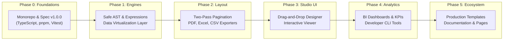

# OpenReport Implementation Roadmap

---

### Figure 12.1: Phased Release Roadmap & Milestones

---

## Milestone Progress Checklist

- [x] **Phase 0: Technical Foundation & Architecture**
  - [x] Monorepo workspace configuration (`pnpm`, TypeScript, Vitest, Tailwind, ESLint).
  - [x] Core architecture and technical vision documentation.
  - [x] Universal Report Specification schema definition with validation and versioning.
  - [x] Comprehensive test harness setup.

- [x] **Phase 1: Core Engine & Safe Expression Language**
  - [x] Sandboxed Expression AST Lexer, Parser, and Evaluator.
  - [x] Math, String, Date, Logical, and Aggregation function libraries.
  - [x] In-memory, JSON, and CSV Data Providers.
  - [x] Data transformation pipeline: filtering, sorting, multi-level grouping, and calculated fields.

- [x] **Phase 2: Layout Engine, Pagination & Exporters**
  - [x] Banded document layout model (`ReportHeader`, `PageHeader`, `GroupHeader`, `Detail`, `GroupFooter`, `PageFooter`, `ReportFooter`).
  - [x] Accurate typography measurement and text wrapping.
  - [x] Multi-pass pagination with `PageNumber` of `TotalPages` resolution.
  - [x] PDF Exporter (vector shapes, text, borders, headers/footers, multi-page).
  - [x] Excel (XLSX) Exporter (cell formats, numbers, dates, column widths).
  - [x] CSV Exporter with RFC-4180 compliance and CSV injection mitigations.
  - [x] HTML & SVG rendering.

- [x] **Phase 3: Visual Designer & Interactive Viewer**
  - [x] Desktop-class Web Report Designer with drag-and-drop, snapping grid, and rulers.
  - [x] Component Palette: Text, Table, Image, Line, Rectangle, Barcode/QR, Chart, KPI Card.
  - [x] Interactive Properties Inspector with field data-binding and styling controls.
  - [x] Undo/Redo history stack and layer management.
  - [x] Interactive Report Viewer with page zoom, continuous scrolling, parameter pane, and direct exports.

- [x] **Phase 4: Analytics, Dashboards & CLI**
  - [x] Dashboard Composition Engine with multi-column responsive grid layout.
  - [x] Interactive KPI cards and Charts (Bar, Line, Area, Pie/Donut).
  - [x] Interactive cross-filtering between dashboard widgets.
  - [x] Standalone OpenReport CLI (`validate`, `inspect`, `export`, `init`).

- [x] **Phase 5: Production Studio Application & Templates**
  - [x] Full-featured OpenReport Studio web application.
  - [x] Built-in real-world enterprise templates (Sales Invoice, Executive Summary, Stock Inventory, Sales Dashboard).
  - [x] End-to-end verification and testing.
