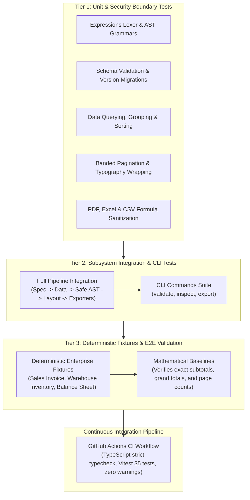

# OpenReport Quality Assurance & Testing Guide

---

### Figure 13.1: Quality Assurance & Multi-Tier Verification Pyramid



---

## 1. Testing Strategy
OpenReport implements a comprehensive, multi-layer testing pyramid:

1. **Unit Tests**:
   - `packages/expressions`: Lexer tokenization, AST parser grammar, operator precedence, null-handling semantics, mathematical functions, string operations, date calculations, and sandboxing security boundaries.
   - `packages/schema`: Schema validation, defaults application, error path reporting, and version migrations.
   - `packages/data-engine`: In-memory querying, CSV parsing, data transformations, multi-level grouping, and sorting.
   - `packages/layout-engine`: Geometry calculations, text measurement, page-break decisions, band sequencing, and two-pass variable resolution.
   - `packages/exporters`: PDF generation validity, Excel workbook structure, CSV output quoting, and formula-injection defenses.

2. **Integration Tests**:
   - End-to-end report rendering: definition -> data binding -> layout engine -> PDF/Excel/CSV document output.
   - CLI execution tests: validation, inspection, and export commands.

3. **Deterministic Fixture Tests**:
   - Fixed sample datasets (e.g., Northwind-style sales orders, regional inventory, financial balance sheets).
   - Expected page counts and summary calculations verified against known mathematical baselines.

## 2. Running Tests
```bash
# Run all tests across the monorepo
pnpm test

# Run tests with coverage
pnpm test --coverage

# Run tests in watch mode during development
pnpm test:watch
```
